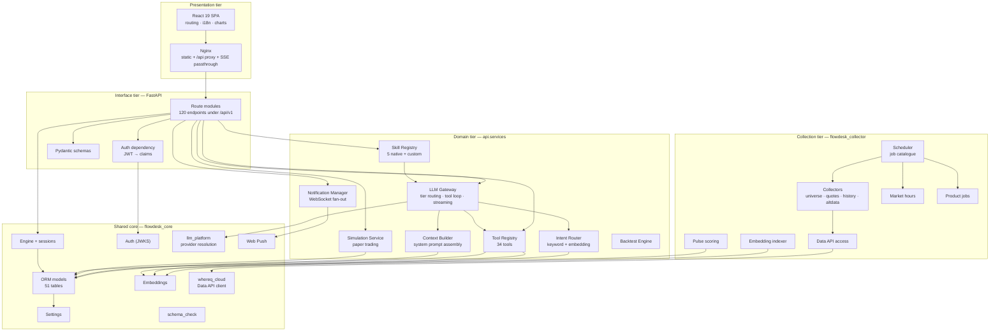
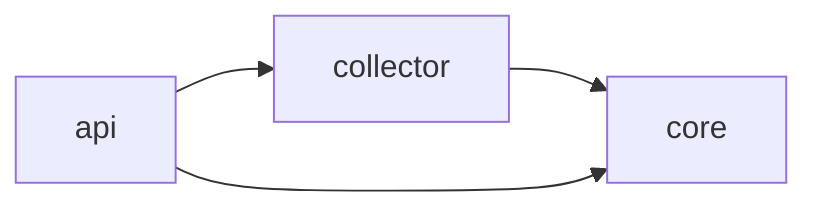
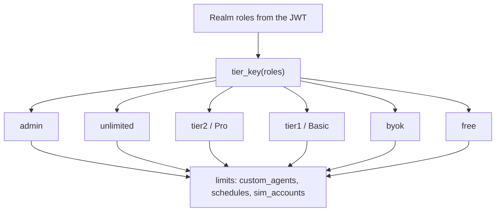
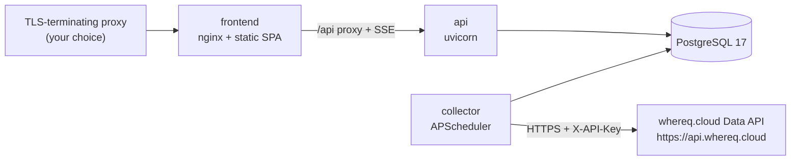

# FlowDesktop — High-Level Design

This document describes the system at the level of **components and
responsibilities**: what each part owns, where the boundaries fall, how the data
model is organised, how the key subsystems are designed, how the system can be
deployed, and where it can be extended.

It stays above the file level. For module-by-module implementation detail, see
[design-low-level-design.md](design-low-level-design.md). For the running shape
of the system, see [architecture.md](architecture.md).

---

## 1. Design principles

Five principles shaped the system. Each one is a decision, not an aspiration,
and each carries a cost.

**1. Data-grounded, not recall-grounded.** NOVA reaches facts through tools
against PostgreSQL. The model never invents a price, a date, or a filing. The
cost is that every new data source needs a tool written for it.

**2. Self-hostable, but it needs one credential.** All market data comes from
the whereq.cloud Data API, so a deployment needs an API key; the LLM can run
entirely in BYOK mode where each user supplies their own. The cost is a single
metered dependency instead of a chain of unofficial endpoints.

**3. The database is the contract.** One schema, one Alembic revision tree, one
set of ORM models shared by every process. The API, the collector, and NOVA's
tools all read the same tables through the same handlers.

**4. Guardrails are structural, not advisory.** The model cannot write on the
user's behalf — write tools return proposals that the UI confirms. Identity comes
only from a verified JWT. Money is `Decimal` end to end. These are enforced by
code paths, not by prompt text alone.

**5. Configuration over code.** Skills, tools, notification preferences, market
rules, and Pulse thresholds are all data. Adding a skill or a market is a
configuration change, not a fork.

---

## 2. Components and responsibilities

### 2.1 Component map



### 2.2 Boundaries and what enforces them

| Boundary | Enforced by | Consequence of a violation |
|---|---|---|
| Browser → API | JWT verification (`get_current_user`) plus route-level `Depends` | 401 on a missing, expired, or invalid token; 403 when a role is missing. |
| API → Database | SQLAlchemy ORM; owner-scoped `WHERE keycloak_id = :uid` | Cross-user reads return nothing rather than another user's rows. |
| LLM → Database | The tool catalogue — 34 named functions with declared parameters | The model cannot issue arbitrary SQL; the surface is bounded and auditable. |
| LLM → writes | Proposal-only tools | The model prepares an action; the user confirms; the frontend performs the REST call. |
| Collector → Data API | `flowdesk_core.whereq_cloud.WhereqCloudClient` — one client, one payload shape, one key | A vendor-specific response shape cannot leak into the write path. |
| Source → database | Unique constraints per target table | A repeated collection run is a no-op, not a duplicate. |
| Process → process | PostgreSQL only. The API and collector share no in-process state. | Either process can be restarted or scaled independently. |

### 2.3 The `flowdesk_core` boundary

`flowdesk_core` is the only package both the application tier and the collection
tier import. It holds:

- **Settings** — one Pydantic settings class, the single source of truth for
  every environment variable.
- **The engine and session factory** — one async engine, one `get_db` dependency.
- **The ORM models** — all 51 tables. This is why a collector job and an API
  route can never disagree about a column.
- **Auth** — JWKS caching and JWT verification.
- **The whereq.cloud Data API client** — `whereq_cloud.WhereqCloudClient`, the one
  place that attaches the API key and maps errors, so the API and the collector
  cannot disagree about how the key is sent.
- **`llm_platform`** — provider resolution and the non-streaming internal LLM
  call, deliberately free of API-layer or collector-layer imports so both
  containers can use it without side effects.
- **Embeddings, Web Push, notifications, schema check.**

`flowdesk_collector` depends on `flowdesk_core` and adds the collection layer:
the scheduler, the collectors, market hours, Pulse, and the product jobs. It
has no market-data access layer of its own — every fetch goes through the
core client.

`api` depends on both and adds the application layer: routes, services, schemas.

The dependency direction is strictly one-way:



---

## 3. The three processes, and why they are split that way

### 3.1 API — `flowdesk-api`

**Owns:** HTTP and WebSocket transport, authentication, the NOVA chat loop, the
tool and skill registries, quota enforcement, entitlements, the simulator's
serving surface, the payment webhook, and the `pg_notify` listener.

**Does not own:** data collection, schema definition, background scheduling.

**Characteristics:** latency-sensitive, request-driven, stateless apart from the
in-process WebSocket connection registry and the JWKS cache. It can be scaled
horizontally — with the caveat that the `pg_notify` listener is per instance, so
a notification reaches only the clients connected to the instance that received
it.

### 3.2 Collector — `flowdesk-collector`

**Owns:** the scheduled job catalogue, the market-hours gating, the universe
sync, and (in all-in-one mode) the product jobs.

**Does not own:** serving, authentication, schema, the Data API client.

**Characteristics:** I/O-bound and externally rate-limited. It is bursty — quote
collection runs every few minutes but stops entirely when every market is
closed; history backfill runs every four hours and skips symbols that are
already current.

The scheduler runs in **UTC**. Each job body is wrapped so a failure is logged
with a traceback rather than killing the scheduler, and blocking sockets are
bounded by `COLLECTOR_SOCKET_TIMEOUT` so a wedged API call cannot hang a
worker thread indefinitely.

### 3.3 Frontend — `flowdesk-frontend`

**Owns:** routing, the API client, authentication state, i18n, and rendering —
including the streaming chat, inline charts, confirmation cards, and the
citations row.

**Does not own:** any business logic. The frontend calls the same REST
endpoints NOVA's tools call, and receives the same response shapes.

It is a static build served by nginx, which also reverse-proxies `/api` to the
API service. Two nginx settings are load-bearing: `proxy_buffering off` (so
Server-Sent Events stream rather than buffer) and `proxy_read_timeout 300s` (so
a long analysis is not cut off mid-stream).

### 3.4 Why not one process

A single process would couple three unrelated failure domains: a Data API
rate-limit, an LLM outage, and a traffic spike are all different problems with
different remedies. Splitting them means:

- A Data API outage leaves the API serving cached data normally.
- The collector can be scaled up during a backfill without touching the API.
- The collector can be run on a different machine from the API — a real
  consideration for a self-hoster whose home connection has asymmetric
  bandwidth.

The cost is operational surface. The compose file collapses all three into one
stack for small deployments, so the separation is available without being
mandatory.

### 3.5 The split topology

`flowdesk_collector.scheduler --product-only` registers only the product jobs,
and `worker/main.py` exposes the same product jobs in the application runtime.
This exists for deployments where data collection is hosted elsewhere but the
product-side work — scheduled agents, the simulator matcher, daily snapshots —
still needs `api.services` to be importable. The two paths share one source of
truth for both the logic and the schedule.

---

## 4. Data model

51 tables in one PostgreSQL database, grouped into six domains. The full
column-level reference is in [database.md](database.md); this section explains
the grouping and the ideas behind it.

### 4.1 Universe and prices

`stocks` is the spine. Every other market-data table either references it by
`stock_id` (`quotes`, `historical_prices`) or carries the symbol as a
denormalised text column (`insider_transactions`, `short_interest`,
`company_filings`, `congress_trades`).

The denormalisation is deliberate for the alternative-data tables. Those tables
are keyed by bare tickers, and joining them back through `stocks` on every read
would cost a lookup for no benefit — the symbol *is* the key the Data API
addresses. `stocks` is also the soft-delete boundary: `is_active=False` means
the symbol is no longer collected, and its rows stay.

`quotes` is an append-only log — one row per symbol per collection run — so a
symbol that stops trading still has a visible price history. `historical_prices`
is the daily OHLCV series, one row per symbol per trading day.

The `stocks` table is a projection of the whereq.cloud catalog. The `sync_universe`
job walks the catalog exchange by exchange — the exchange list is what carries
each exchange's market and currency — and upserts every instrument. An
instrument the catalog no longer lists is soft-deleted, never removed.

### 4.2 Alternative data

The corporate-information tables. `company_filings` holds the SEC's 10-K and
10-Q primary documents verbatim in `content`; `insider_transactions` holds one
row per Form 4 transaction; `short_interest` holds one snapshot per
settlement date; `congress_trades` holds STOCK Act disclosures.

Two of these are **not populated out of the box**. The Data API exposes SEC
filing *metadata* by CIK — not the 10-K/10-Q narrative the grounding index
embeds, and not a ticker→CIK mapping — so `company_filings` stays empty unless
an operator populates it. The API does not expose congressional disclosures at
all, so `congress_trades` stays empty for the same reason. The tables, the
tools, and the UI panels all remain; `FILINGS_ENABLED` defaults to `False`.
See [architecture.md §3.3](architecture.md#33-the-two-documented-data-gaps).

`fundamental_data` stores XBRL concepts keyed by
`(symbol, concept, period_end, form)` — one row per fact per filing, which
makes restatement history naturally auditable. `macro_indicators` stores
time series keyed by `(series_id, indicator_date)`. `market_events` holds the
earnings and dividend calendar, discriminated by a `kind` column so the calendar
feed is a single query.

`chinese_stock_names` is a standalone name registry: the Chinese-language
display name for a symbol, kept separate from `stocks.name_cn`.

### 4.3 Market intelligence

`market_news_items` holds raw articles; `market_signals` holds the AI-extracted
structure derived from them — sentiment, confidence, impact horizon, affected
sectors, mentioned symbols, and theme tags. One signal per news item.

`retrieval_chunks` is the pgvector index that makes semantic search work. It is
not tied to one source type: `source_type` discriminates between `news`,
`signal`, `sector`, and `filing`, and the `owner_id` column separates global
content from a user's private conversation content. The `model` column records
which embedding model produced a vector, so a model change can be handled by
re-indexing rather than by a mixed-dimensional index.

### 4.4 User

Everything keyed by the OIDC subject UUID. `user_profiles` holds display
preferences (timezone, locale, currency, avatar); `investor_profile` holds the
structured investing style that Pulse scoring consumes — risk tolerance,
horizon, style, preferred and avoided sectors; `watchlists` holds saved symbols;
`user_alerts` holds price and change-percentage triggers; `user_memories` holds
free-form key/value facts NOVA is asked to remember; `notification_prefs` holds
the push fan-out toggles and quiet hours; `push_subscriptions` holds the
browser endpoints for Web Push.

`chat_quotas` is the free-trial ledger: `trial_start` is set once on the first
message and never moves, `messages_used` only increments, and there is no reset.

`message_feedback` stores a self-contained snapshot of each rated answer —
question, answer, agent, tools, model, rating — so the eval golden set can grow
from real feedback without joining live tables.

### 4.5 Chat and agents

`conversations` and `messages` implement opt-in server-side persistence with a
rolling summary: once six messages accrue beyond the last summary, the most
recent twenty are folded into a compact extractive summary by the cheap model
and the older turns are dropped from the request. A request without a
`conversation_id` behaves exactly as it did before persistence existed.

`custom_agents` holds user-built agents. `agent_schedules` holds recurring runs,
keyed to a native skill name or a custom-agent slug, with the time stored as
local wall-clock plus an IANA timezone so "9am my time" resolves correctly
across daylight-saving transitions.

`shared_analyses` holds publishable analyses with a short random slug, served
as server-rendered HTML for search engines and link previews.
`shadow_trades` is a simpler paper-trade log used by the portfolio tooling.
`proactive_insights_sent` is the dedup ledger that makes Pulse idempotent across
collector restarts; `pulse_tuning` is a singleton row holding the auto-tuned
score cutoff.

### 4.6 Simulator

Five tables. `sim_accounts` holds the cash balance and the initial balance.
`sim_orders` is the order book — market and limit orders, with a time-in-force
and an idempotency key. `sim_positions` holds the aggregate position per
symbol. `sim_fills` is an immutable ledger: one row per execution, with the
fee, the cash delta, and the realised P&L. `sim_snapshots` holds the daily
mark-to-market that produces the equity curve.

The split between `sim_positions` (current state) and `sim_fills` (history) is
what makes the account auditable: positions can be recomputed from fills, and
the fills are never rewritten.

### 4.7 Platform

`provider_status` tracks the availability of the one data source and whether its
API key is configured; `provider_registry` is the descriptive catalogue of what
that source supports. `crawl_coverage` records which symbols were successfully
collected on which date, which is what gap detection reads. `crawler_run_log`
records per-run timing and throughput statistics.

`data_source` catalogues the external data sources with their API base, whether
they need a key, and their rate limits. `domains`, `entities`,
`entity_identifiers`, and `datasets` form a registry spine that lets the
platform describe domains beyond finance: `domains` is an adjacency-list
taxonomy with a materialised path for subtree queries, `entities` is the
generic per-domain directory, `entity_identifiers` holds the external
identifiers for an entity, and `datasets` is the catalogue of what each domain
offers.

`translations` is a cache of translated content keyed by a hash of the source
text and the target language.

---

## 5. Key subsystem designs

### 5.1 The NOVA skill system

A skill is a frozen dataclass:

| Field | Meaning |
|---|---|
| `name` | Stable identifier, e.g. `research_analyst`. |
| `title` | Display name in the catalogue. |
| `category` | Research / Compare / Strategy / Portfolio. |
| `description` | One line, used by the catalogue and the router. |
| `system_prompt` | Focused instructions appended to NOVA's base prompt. |
| `tools` | Curated subset of the 34 tool names. |
| `model_tier` | `light` / `heavy` / `auto`. |
| `temperature`, `max_tokens` | Sampling configuration. |
| `example_prompts` | Seed prompts shown in the UI. |
| `maturity` | `stable` / `beta` / `planned` / `custom`. |
| `icon` | Emoji shown in the catalogue. |

Five native skills ship: **Research Analyst** (a full single-stock brief),
**Stock Comparator** (side-by-side ranking), **Portfolio Doctor** (exposure,
P/L, concentration, and risk review), **Strategy Architect** (entry/exit/sizing
proposals, grounded in a backtest where the idea is testable), and **Catalyst
Tracker** (upcoming earnings, dividends, and news).

A skill's **tool subset** is the load-bearing part. It serves three purposes at
once: it cuts prompt tokens, it prevents a persona from calling a tool that
makes no sense for it, and it narrows the blast radius of a confused model.

A user-built agent is a `custom_agents` row hydrated into the same dataclass by
`hydrate_custom_agent`, so it runs through the identical `run_skill` path and
inherits every guardrail. The write path validates the tool list against the
registry, so a custom agent cannot request a tool that does not exist.

**Routing to a skill** is two-tier. `classify_skill` matches against an ordered
list of keyword cues — checked most-specific first, so "catalyst" wins over
"analysis" — and is deliberately conservative: it is a suggestion aid, not an
auto-dispatch. When it finds nothing, `route_skill_embedding` computes a local
embedding of the query and compares it against embedded skill descriptions,
returning a skill only above the tuned similarity threshold and `None`
otherwise.

### 5.2 The tool registry

A single class, `ToolRegistry`, exposes the catalogue as OpenAI-function-calling
definitions. LiteLLM translates them to each provider's native format.

The tool contract has four parts:

1. **Definition** — name, description, and a JSON-Schema parameter object.
   The description is written for the model: it says *when* to use the tool, not
   just what it returns. "Call this for 'what's the news/sentiment on X', 'why
   is X moving', or to verify a claim the user pasted" is the pattern.
2. **Dispatch** — `execute()` maps a tool name to a handler. The dispatch is a
   flat `if`/`elif` chain over the name, which keeps the mapping greppable and
   keeps each handler's signature explicit.
3. **Result** — a JSON-serialisable dict. Two keys are special: `_proposal`
   carries a gated write action, and `_chart` carries an inline chart spec.
   Both are popped out of the result before it is sent to the model, so the
   model sees a plain text acknowledgement and the UI gets the rich payload.
4. **Failure** — any exception inside a handler is caught and turned into
   `{"error": "Tool <name> failed: ..."}`. A failing tool degrades the answer;
   it never fails the chat.

The 34 tools fall into nine groups:

| Group | Tools |
|---|---|
| Market data | `get_stock_quote`, `get_price_history`, `get_technical_indicators`, `get_fundamentals`, `get_market_movers`, `compare_stocks`, `get_sector_summary`, `fetch_live_quote` |
| Intelligence | `get_news_and_signals`, `semantic_news_search`, `get_sector_intelligence`, `get_peers_and_correlations`, `get_macro_indicators`, `get_calendar_events` |
| Corporate filings | `search_filings`, `get_insider_activity`, `get_short_interest`, `get_congress_trades` |
| Personal data | `get_watchlist`, `get_portfolio`, `get_user_alerts`, `save_memory`, `search_my_conversations`, `get_sim_portfolio` |
| Analysis | `run_backtest`, `run_sim_backtest`, `render_chart` |
| Discovery | `search_stocks` |
| Web | `web_fetch`, `web_search` |
| Proposals | `propose_create_alert`, `propose_add_to_watchlist`, `propose_record_trade`, `propose_sim_order` |

### 5.3 Intent routing

Three distinct routing decisions, deliberately kept apart:

| Decision | Mechanism | Where |
|---|---|---|
| **Which model tier?** | Keyword and length heuristic → local-embedding fallback | `llm_gateway._route_heavy` |
| **Which skill?** | Keyword cues → local-embedding fallback | `skills.classify_skill`, `router.route_skill_embedding` |
| **How much history to forward?** | Soft token cap with extractive compaction | `conversation_manager.prepare_messages` |

The tier decision is the one with a cost dimension: a light model for lookups, a
heavy model for analysis. The heuristic matches an English cue list and a
Chinese cue list, and treats a prompt longer than 280 characters or containing
two or more question marks as analytical. It returns `True` on a clear signal
and `False` only when it finds *no* signal, which the embedding fallback then
resolves.

The embedding fallback is multilingual because the local model is. It compares a
query embedding against a cached set of tier exemplars and decides by **margin**
— `heavy_sim - light_sim >= 0.03` means heavy, the inverse margin means light,
and anything closer than that returns `None` ("undecided"). Deciding by margin
rather than by absolute similarity is robust to the absolute scale differences
between embedding models.

The skill fallback uses a different threshold (0.33) and a different rationale:
the keyword matcher already covers the precise English cases, so the embedding
path only needs to surface *confident* matches, mostly non-English ones. Below
that it returns `None`, which is safe — the caller keeps the generalist chat.

Every path in the embedding router is defensive. Any failure returns `None` and
the caller keeps its previous behaviour, so **routing never breaks a chat**.

### 5.4 The LLM gateway

The gateway is the single place where a request becomes an LLM call. It owns:

- **Provider resolution.** `resolve_platform_provider()` honours an explicit
  `PLATFORM_LLM_PROVIDER`, otherwise it walks a fixed order and takes the first
  provider with a configured key. It returns the provider name, the default
  model, and the key.
- **Model-string construction.** `build_litellm_model_string` prefixes the
  model with the provider's LiteLLM route, or switches to OpenAI-compatible mode
  (`openai/<model>` plus a custom `api_base`) for providers that need a
  non-default endpoint.
- **Tier routing.** As above.
- **Provider quirks.** Anthropic's adaptive-thinking models reject a
  `temperature` parameter and use `thinking={"type": "adaptive"}` instead, so
  the gateway detects them and adjusts the request. Anthropic also gets a
  `cache_control` breakpoint on the system message, so the large, stable system
  prompt is cached across turns of a session; other providers ignore the
  attribute.
- **The tool loop.** Streaming completions, fragment accumulation, execution,
  re-submission, and a hard cap of six rounds after which `tool_choice="none"`
  forces a final answer.
- **Error normalisation.** Provider exceptions become a structured `LLMError`
  with a machine-readable code: `quota_exhausted`, `rate_limit`, `auth_error`,
  `context_too_long`, `provider_unavailable`, `transient`. The frontend maps
  these to localised strings; a raw provider message never reaches the user.
- **Observability.** One structured log line per run: the model, the tier, the
  number of exposed tools, the number of tool rounds, which tools ran, the
  latency, and token usage when the provider reports it.

### 5.5 The entitlement model

Entitlements are a **capability** model, separate from the chat quota. The chat
quota governs how many messages a user may send; entitlements govern how many
*resources* a user may hold.



| Tier | Custom agents | Schedules | Simulator accounts |
|---|---|---|---|
| Admin | 100 | 50 | 100 |
| Unlimited | 50 | 20 | 50 |
| Pro (`fd-tier-2`) | 20 | 10 | 20 |
| Basic (`fd-tier-1`) | 5 | 3 | 5 |
| BYOK (`fd-tier-byok`) | 20 | 0 | 5 |
| Free | 2 | 0 | 2 |

The tier is derived from the realm roles in the verified token — highest
priority first, admin overriding everything. Enforcement happens at the write
route: the current count is compared against the cap and a 402 is raised with
the tier's friendly label. `GET /api/v1/me/entitlements` returns the limits and
the current usage so the UI can show plan state and gate paid affordances.

Note that the BYOK tier gets zero schedules. This is not an oversight: scheduled
agent runs execute on the *platform* provider and do not pass through
chat-quota enforcement, so granting schedules to a free or BYOK tier would be a
quota bypass. Making schedules a paid capability closes it.

### 5.6 The paper-trading simulator

A learning tool, not a broker. The design points that matter:

**Money is `Decimal` everywhere.** `Numeric` columns, `Decimal` values, and
explicit quantisation — `Decimal("0.0001")` for cash, `Decimal("0.000001")` for
prices, both `ROUND_HALF_UP`. No float ever touches a balance.

**Validation is a pure function.** `validate_order` takes the account state, the
stock state, and the order, and returns a rejection reason or `None`. It checks
the account is active, the side and order type are valid, the symbol is not
delisted, the symbol's currency matches the account's, the quantity is positive
and a whole number of board lots, a limit order has a positive limit price, a
buy has sufficient buying power, and a sell has sufficient shares — shorting is
not permitted. Because it is pure, it is exhaustively unit-tested.

**Fills are transactional.** The fill path takes a row lock on the account
(`FOR UPDATE`), re-validates affordability and holdings at fill time, and
applies cash, position, the fill ledger row, and the order status together. The
matcher processes each order in its own transaction, so one bad order cannot
roll back another.

**Orders rest and expire.** A market order placed while the market is closed
rests until the matcher runs. A limit order always rests and expires at the end
of the UTC day. A fill requires a fresh quote — while the market is open, a
quote older than `sim_quote_max_age_minutes` is treated as no price at all.

**Market rules are data.** `market_rules.py` is a dictionary keyed by account
currency. `USD`, `CAD`, and `HKD` use a lot size of 1; `CNY` uses 100 with
T+1 settlement and a ±10% daily limit; `JPY` and `SGD` use 100; `TWD` uses
1000; `KRW` uses 1. Adding a market is a one-line addition.

**Valuation is mark-to-market.** `value_account` prices every position at the
latest quote, computes unrealised P&L, position weights, equity, total return,
and the day change measured against the most recent prior snapshot.

### 5.7 Notifications

`emit_notification` in `flowdesk_core.notifications` is the single entry point,
shared by the API and the collector so that either can raise a notification
without depending on the other's runtime. It performs three deliveries:

1. **In-app** — writes a `user_notifications` row. The caller commits.
2. **Real-time** — issues `pg_notify('user_notifications', payload)`. The API's
   listener receives it and pushes it over the WebSocket to every connection
   registered for that user.
3. **Web Push** — if the user's preferences allow this notification type and
   VAPID is configured, sends to every stored browser subscription. Endpoints
   that the push service reports as gone (404/410) are pruned.

The function flushes but does not commit, so a batch caller can commit once
after several emits. Metadata is coerced to JSON-safe types first — a `NUMERIC`
column surfaces as `Decimal`, which `asyncpg` cannot encode into a JSONB
parameter, and an unsanitised metadata dict would poison the session's flush and
take the whole job down.

Delivery never breaks the write: the Web Push fan-out is wrapped so a push
failure is logged and swallowed.

### 5.8 Pulse — proactive relevance scoring

The relevance score for a (signal, investor-profile) pair is:

```
score = confidence × |sentiment| × recency × horizon_fit × style_fit × sector_mult
```

- `recency = exp(-age_hours / 12)` — roughly an eight-hour half-life.
- `horizon_fit` — from a table crossing the profile's horizon (`day`, `swing`,
  `long_term`) with the signal's impact horizon (`intraday`, `short`, `medium`,
  `long`).
- `style_fit` — 1.0 when the signal type matches the profile's style, 0.8
  otherwise.
- `sector_mult` — 1.15 when the affected sector is explicitly preferred, 0.4
  when it is explicitly avoided, 1.0 otherwise.

A signal with no sentiment or no confidence scores exactly `0.0` and is never
pushed. The score is computed in plain Python so it is free, reproducible, and
testable; the LLM is spent only on the survivors, on one batched "why it
matters" call, with a templated fallback if that call fails or returns an
incomplete batch.

The threshold itself auto-tunes from 👍/👎 feedback, but only once a quorum is
met: below `pulse_tune_min_votes` it holds; below 50% approval it raises the
cutoff (be more selective); at or above 80% it lowers it (widen coverage);
otherwise it holds. The result is always clamped to the configured band.

---

## 6. Deployment topology

### 6.1 Role A — all-in-one



Four processes on one host, or four containers on one Docker host. The
collector runs both the collection jobs and the product jobs. This is the
compose default and the right shape for a single-machine self-host.

The frontend and the API are served from one origin, so the SPA's relative
`/api/v1` base path works unchanged and there is no cross-origin SSE.

### 6.2 Role B — split

The collector runs on a separate host from the API. Use
`--product-only` on the application side, or `worker/main.py`. The database is
the only shared component; there is no direct process-to-process traffic.

The right shape when collection is expensive — a large universe on a slow
link — or when the deployment already runs a shared database service.

### 6.3 What the deployment must provide

| Concern | Requirement |
|---|---|
| Database | PostgreSQL 17 with `vector` and `pg_trgm`. The API and collector both connect. |
| Market data | A whereq.cloud API key. Every market-data request is made with it; there is no anonymous path. |
| Identity | An OIDC provider issuing RS256 JWTs with a realm-roles claim. The shipped values are placeholders and must be replaced. |
| LLM | Either a platform provider key, or BYOK users supplying their own. |
| TLS | A TLS-terminating reverse proxy in front of the frontend. The application does not terminate TLS. |
| Outbound network | HTTPS to the whereq.cloud Data API and the LLM provider. |
| Clock | UTC. The scheduler and the market-hours table are both UTC-based. |

---

## 7. Extension points

### 7.1 Adding a data source

**Where:** `backend/packages/flowdesk-core/flowdesk_core/whereq_cloud.py` for
the client, `backend/packages/flowdesk-collector/flowdesk_collector/collectors/`
for the write path.

There is one data source today, and the extension points are shaped around
that:

1. **A new endpoint on the Data API.** Add a method to
   `WhereqCloudClient` — it holds the base URL, the key, the timeout and the
   retry policy, so a new method only has to describe the request and the
   response shape.
2. **A new payload shape.** Add a mapping function to
   `collectors/mapping.py`. The mappings are pure functions with no database
   and no network, so each one is unit-testable on its own and the collector
   stays a thin write path.
3. **A new collector.** Add a function next to `collectors/quotes.py`,
   `history.py`, and `altdata.py` that fetches through the client, maps the
   payload, and upserts on the target table's unique constraint.
4. **A new job.** Register it in `scheduler.py` and set its cadence. Every
   job body is wrapped so a failure is logged rather than fatal.
5. **A new surface.** Add a tool to the registry (see 7.3) if NOVA should be
   able to ask for it.

A second data source — a different vendor's API, or a file you drop on disk —
means a second client module beside `whereq_cloud.py` and the same four steps
from there. The optional-key-provider list that used to exist (per-vendor API
keys for price and fundamentals vendors) is gone: there is one key, and it is
the whereq.cloud one.

### 7.2 Adding a skill

**Where:** `backend/api/services/skills.py`.

1. Construct a `Skill` — a frozen dataclass — with a name, title, category,
   description, system prompt, tool subset, model tier, temperature, and token
   budget.
2. Add it to the `SKILLS` registry tuple.
3. Add keyword cues to `_ROUTER_CUES`, most-specific first.

The tool subset is validated against the registry, so the skill compiles only
with tools that exist. To expose new data to the skill, add the tool first
(see 7.3).

### 7.3 Adding a tool

**Where:** `backend/api/services/tool_registry.py`.

1. Add the definition to `_all_definitions()` — name, description, JSON-Schema
   parameters. Write the description for the model: say when to use it.
2. Add the handler method, prefixed `_`, taking `(self, db, ...)` and returning
   a JSON-serialisable dict.
3. Add the dispatch branch in `execute()`.
4. If the tool is proposal-only, use `_propose` so the write stays gated.
5. If the tool is chart-producing, return a `_chart` key alongside the result.
6. Add the tool to any skill's `tools` tuple that should have it.

For the custom-agent builder to offer it, the tool must exist in the registry —
`_VALID_TOOLS` in `api/routes/me_agents.py` is derived from
`ToolRegistry().get_definitions()`, so it picks the new tool up automatically.
Add a friendly label to `TOOL_LABELS` in
`frontend/src/components/chat/ChatMessage.tsx` for the citations row.

### 7.4 Adding a route

**Where:** `backend/api/routes/`.

1. Create a module with an `APIRouter(prefix="/...")`.
2. Import it in `backend/api/main.py` and mount it with `include_router(...,
   prefix="/api/v1")`.
3. Use the `CurrentUser` dependency for authenticated routes and `Depends(get_db)`
   for the session.

A route that reads the same data NOVA reads should call the same
`ToolRegistry` handler so the two response shapes cannot drift. The
`/api/v1/stocks/{symbol}/insider` route is the model for this: it calls
`_tools._get_insider_activity`, which is exactly what the `get_insider_activity`
tool calls.

### 7.5 Adding a database table

1. Create the model in `backend/packages/flowdesk-core/flowdesk_core/models/`.
2. Export it from `models/__init__.py`.
3. Generate a migration:

   ```bash
   cd backend
   alembic revision --autogenerate -m "add_<table>"
   ```

4. Review the generated file — autogenerate is a starting point, not an answer.
5. Apply it: `alembic upgrade head`.
6. Verify: `python -m flowdesk_core.schema_check`.

Never call `Base.metadata.create_all()` — it races with Alembic.

### 7.6 Adding a market or a currency

For a trading currency, add one line to `MARKET_RULES` in
`api/services/market_rules.py`. For a collection market, add its trading window
to `_HOURS` in `flowdesk_collector/market_hours.py` and its alias mapping to
`_NORMALIZE`.

---

## 8. Design decisions, summarised

| Decision | Benefit | Cost |
|---|---|---|
| One keyed data source | A single credential and a single payload shape | A metered dependency, and two documented data gaps |
| Three separable processes | Failure isolation, independent scaling | More operational surface |
| Database-mediated tool contract | Bounded, auditable, token-efficient | A tool per data source |
| Declarative skills | One code path for native and custom agents | Misconfiguration fails at runtime |
| Per-turn model tiering | Cost control without credential changes | Heuristic misrouting |
| Proposal-only writes | The model cannot act for the user | An extra confirmation step |
| Database-driven notifications | Durable, no extra infrastructure | Per-instance WebSocket fan-out |
| Soft-deleted symbols | History preserved, no dangling FKs | Every read path must filter `is_active` |
| Deterministic Pulse scoring | Free, reproducible, testable | Encodes one notion of relevance |
| `Decimal` money | Exact ledger arithmetic | Slower, needs care at boundaries |
| Alembic owns the schema | One source of truth, no races | Migration discipline required |
